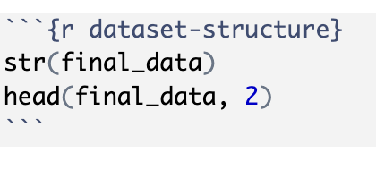

# Section 1: Loading Libraries

```{r setup, include=FALSE}
library(dplyr)
library(ggplot2)
library(knitr)
library(rmarkdown)
```

# Section 2: Research Question

How does the share of electricity generated from renewable sources relate to the share generated from fossil fuels across selected countries?

# Section 3: Dataset Introduction
This analysis uses electricity generation data from [Our World in Data](https://ourworldindata.org/electricity-mix). The dataset examines renewable and fossil fuel electricity generation shares across Australia, Canada, Germany, India and Japan between 2000 and 2024.

The variable `Entity` identifies the country, while `Year` records the observation year. `Renewables` represents the percentage of electricity generated from renewable sources. `Fossil.fuels` represents the percentage generated from fossil fuels.

```{r import-final-data}
final_data <- read.csv("Data/electricity_analysis.csv")
```

```{r variable-table}
variable_names <- data.frame(
  Variable = names(final_data)
)

knitr::kable(
  variable_names,
  caption = "Variables included in the electricity dataset"
)
```

# Section 4: Dataset Description

The dataset contains `r nrow(final_data)` observations and `r ncol(final_data)` variables.

```{r dataset-structure}
str(final_data)
head(final_data, 2)
```

```{r code-screenshot, echo=TRUE, out.width="75%"}

```

The dataset contains one character variable (`Entity`) and three numerical variables (`Year`, `Renewables` and `Fossil.fuels`).

# Section 5: Data Summary

```{r country-summary}
summary_data <- final_data %>%
  select(Entity, Renewables, Fossil.fuels) %>%
  group_by(Entity) %>%
  summarise(
    Average_Renewables = mean(Renewables),
    Average_Fossil_Fuels = mean(Fossil.fuels)
  )

knitr::kable(
  summary_data,
  digits = 2,
  caption = "Table 1: Average renewable and fossil fuel electricity shares by country, 2000–2024"
)
```

Canada recorded the **highest** average renewable electricity share at 62.73%, while Japan had the lowest at 13.15% across the selected period. Australia had the highest average fossil fuel electricity share at 84.68%, compared with Canada's 22.82%, indicating substantial differences in electricity generation mixes across the five countries.

# Section 6: Data Visualisation

```{r electricity-scatter, fig.cap="Relationship between renewable and fossil fuel electricity shares across five countries, 2000–2024"}
ggplot(final_data, aes(x = Renewables, y = Fossil.fuels, color = Entity)) +
  geom_point(size = 2.5, alpha = 0.7) +
  labs(
    title = "Renewable vs Fossil Fuel Electricity Generation",
    x = "Renewable electricity share (%)",
    y = "Fossil fuel electricity share (%)",
    color = "Country"
  ) +
  theme_minimal()
```
- *The scatter plot shows a negative relationship between renewable and fossil fuel electricity shares, with higher renewable shares generally associated with lower fossil fuel shares.*

- *Canada has relatively high renewable electricity shares and low fossil fuel shares, whereas Australia and India generally show greater reliance on fossil fuels.*

# Section 7: Conclusions

The analysis indicates a negative relationship between renewable and fossil fuel electricity generation shares across Australia, Canada, Germany, India and Japan from 2000 to 2024. Countries with higher renewable shares generally recorded lower fossil fuel shares. Canada had the highest average renewable electricity share (62.73%) and the lowest average fossil fuel share (22.82%), while Australia recorded the highest average fossil fuel share (84.68%).

The additional analysis reveals different patterns of renewable electricity development. Germany experienced the largest increase in renewable electricity share between 2000 and 2024, rising by 52.42 percentage points, followed by Australia with an increase of 26.99 percentage points. Canada maintained a relatively high renewable share throughout the period.

These findings suggest that electricity generation mixes differ substantially across countries. However, the relationship is descriptive rather than causal, and other sources, including nuclear power, also contribute to electricity generation.

# Part B: Additional Analysis

## Figure 2: Renewable Electricity Trends
```{r renewable-trends, fig.cap="Figure 2: Renewable electricity generation shares across five countries, 2000–2024"}
ggplot(final_data, aes(x = Year, y = Renewables, color = Entity)) +
  geom_line(linewidth = 1) +
  geom_point(size = 1.5, alpha = 0.7) +
  labs(
    title = "Renewable Electricity Trends (2000–2024)",
    x = "Year",
    y = "Renewable electricity share (%)",
    color = "Country"
  ) +
  theme_minimal()
```

Figure 2 illustrates how renewable electricity shares changed across the five countries between 2000 and 2024. Germany and Australia show substantial increases over the period, while Canada maintains a comparatively high renewable electricity share. These trends demonstrate that countries followed different pathways towards renewable electricity generation.

## Table 2: Renewable Electricity in 2000 and 2024

```{r renewable-comparison-table}
comparison_table <- final_data %>%
  filter(Year %in% c(2000, 2024)) %>%
  select(Entity, Year, Renewables) %>%
  tidyr::pivot_wider(
    names_from = Year,
    values_from = Renewables,
    names_prefix = "Year_"
  ) %>%
  mutate(
    Change_pp = Year_2024 - Year_2000
  ) %>%
  arrange(desc(Change_pp))
knitr::kable(
  comparison_table,
  digits = 2,
  caption = "Table 2: Changes in renewable electricity shares between 2000 and 2024"
)
```

Table 2 compares renewable electricity shares in 2000 and 2024. Germany recorded the largest increase (52.42 percentage points), followed by Australia (26.99 percentage points). Canada experienced a smaller increase of 3.66 percentage points but already had the highest renewable share in 2000. The comparison highlights differences in the pace of renewable electricity growth across countries.
